# Relatório de análise do `mobile/` contra os requisitos do README

Data: 2026-09-24
Escopo: pasta `mobile/` (UI kit) comparada com a stack descrita no `README.md` (web do personal, mobile do aluno, pacotes compartilhados).
Método: cinco agentes especialistas, todos em **modo somente leitura**: `frontend-mobile`, `ui-designer`, `security`, `qa` e `frontend-web`. Nada no projeto foi alterado.

> **Limitação importante.** Nenhum agente conseguiu rodar `typecheck`, `lint` ou testes: `node` não está no PATH do shell e não existe `node_modules` em `mobile/`. Tudo abaixo é **análise estática**. Não há evidência de que o projeto compila. Cada agente indicou quais arquivos leu por completo e quais viu só por busca ou cabeçalho (ver seção 10).

---

## 1. Resumo executivo

O `mobile/` é um **UI kit navegável**, não o app do aluno descrito no README. Ele não atende à stack alvo nem como aplicação: não tem auth, API, testes nem monorepo, e as 14 telas de dados leem `mockData`. O valor dele está no **design system** (tokens, ícones, marca e layout do dashboard). O código dos componentes quase não se reaproveita, porque tudo depende de NativeWind.

| Pergunta | Resposta curta |
|---|---|
| Atende aos requisitos do README? | **Não.** 6 de 16 requisitos divergem, 5 estão ausentes. |
| Há algo reaproveitável? | **Sim**: tokens, ícones, marca, layout do dashboard e telas como referência de UX. |
| Serve para a web? | **Mais do que para o mobile.** O kit já é Tailwind 3.4, mesma base da web alvo. |
| Está pronto para produção? | **Não.** Sem auth, sem guards, sem testes, sucessos falsos na UI. |
| Maior risco? | Falta de guard de rota e de papel (RBAC) e login fora do padrão PKCE. |

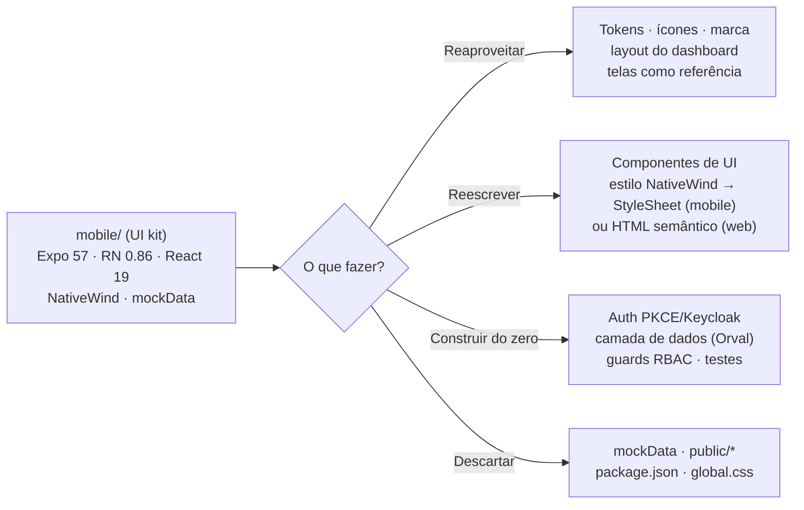

---

## 2. Estado atual contra a stack do README

### 2.1 Matriz de requisitos (16 linhas)

| Requisito do README | Estado | Evidência |
|---|---|---|
| Expo ~52 | Diverge | `expo ~57.0.24` |
| React Native 0.76.3 | Diverge | `react-native 0.86.3` |
| React 18.3.1 | Diverge | `react 19.2.3` |
| Expo Router ~4 | Diverge | `expo-router ^57.0.22` |
| TypeScript 5.9 | Diverge | `typescript ~6.0.3` |
| Sem NativeWind por enquanto | Diverge | `nativewind ^4.2.7`; `babel.config.js:4`, `metro.config.js:2,6` |
| expo-linking | Atende (versão diverge) | `^57.0.10` |
| react-native-screens | Atende | `^4.28.0` |
| react-native-safe-area-context | Atende | `^5.10.0`, usado em `app/_layout.tsx:8` |
| Zod | Atende, com ressalva | `zod ^4.6.5`; alvo é Zod 3 |
| expo-secure-store | Presente, sem uso | `secureStorage.ts` nunca é importado |
| expo-auth-session (PKCE) | Ausente | não está no `package.json` |
| TanStack Query 5 | Ausente | sem `QueryClientProvider` |
| Jest, jest-expo, RNTL, MSW | Ausente | nenhum teste, nenhum script `test` |
| `@aura/schemas`, `@aura/contracts`, `@aura/authz` | Ausente | nenhum import |
| pnpm, Turborepo, `apps/mobile` | Ausente | app em `mobile/`, `package-lock.json` (npm) |

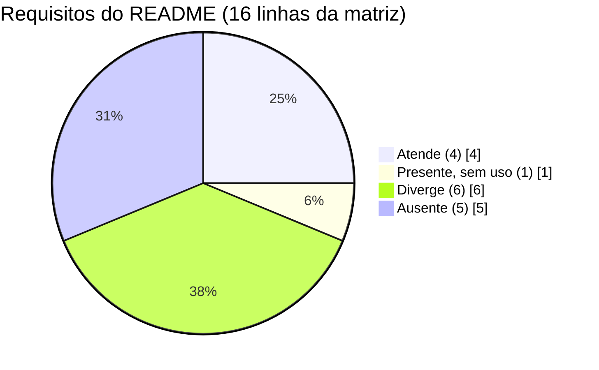

### 2.2 Arquitetura: alvo contra o que existe

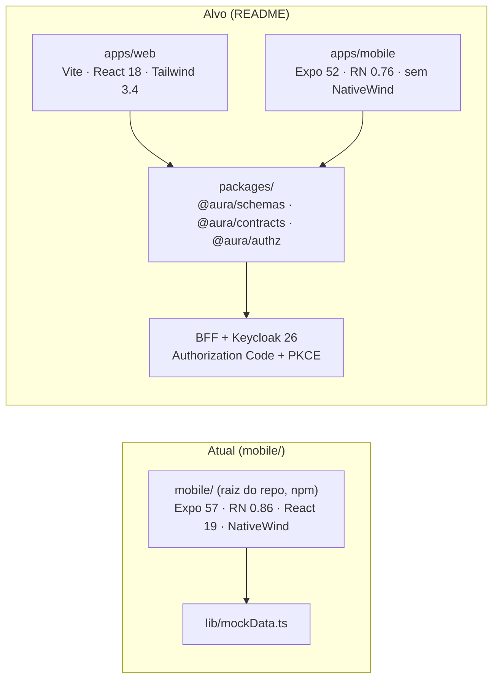

### 2.3 O que o app contém e o que falta

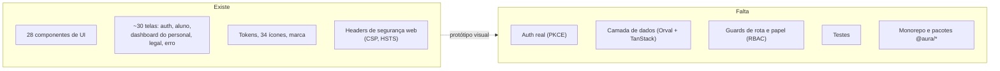

### 2.4 Divergência de escopo

O README define `apps/mobile` como **mobile do aluno**. O kit traz também o **dashboard do personal** (`app/(dashboard)/`), que é uma segunda aplicação embutida, pensada para tablet e desktop.

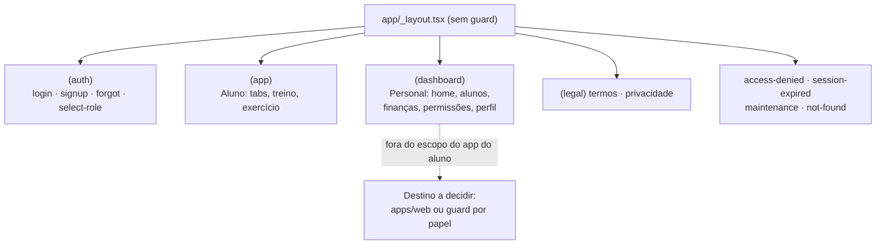

---

## 3. Segurança

O app ainda é protótipo, então não há vazamento de token, segredo no código nem injeção. Os achados são de **controle de acesso ausente**, que precisa existir antes de ligar dados reais.

### 3.1 Achados por severidade (8 achados)

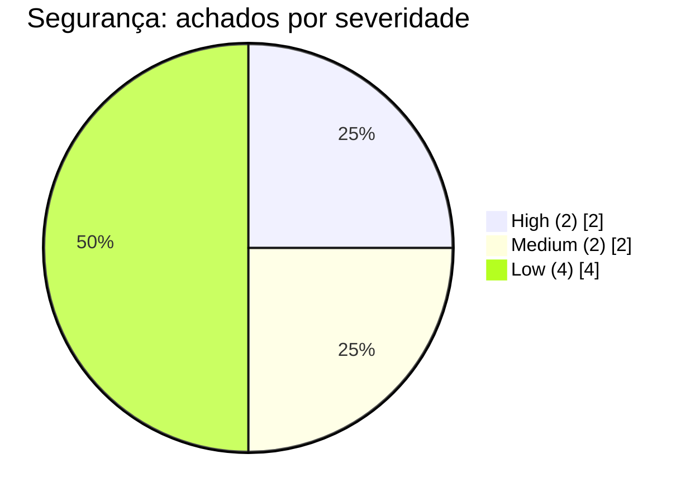

| Sev. | Achado | Onde |
|---|---|---|
| High | Sem guard de rota nem de papel. Qualquer pessoa abre `/students`, `/finance`, `/permissions` por deep link. O papel vem do mock, e `select-role` deixa o usuário escolher o papel no cliente. | `app/index.tsx:4-5`, `(dashboard)/_layout.tsx:25-79`, `app/_layout.tsx:49-54` |
| High | IDOR latente nas rotas com id. Sem risco hoje (mock), mas o backend precisa checar posse ao ligar a API. | `students/[id]`, `workout/[id]`, `exercise/[id]` |
| Medium | Login e social login sem implementação. Risco de implementar depois com senha coletada no app, fora do modelo Authorization Code + PKCE. "Lembrar de mim" não tem efeito. | `login.tsx:17-22, 99-104` |
| Medium | CSP web com `connect-src 'self'`, sem prever BFF ou Keycloak. Está triplicada (meta, `_headers`, `vercel.json`). | `public/index.html`, `_headers`, `vercel.json` |
| Low | `openExternalUrl` loga a URL completa em `__DEV__`. | `openExternalUrl.ts:25-27` |
| Low | `openExternalUrl` permite `tel:` e `mailto:`. | `openExternalUrl.ts:3, 19-24` |
| Low | Scheme `aurafit://` não é exclusivo. Faltam `intentFilters` e `associatedDomains` para OAuth. | `app.json:4` |
| Low | Versões incomuns (expo 57, typescript 6, zod 4) que o agente não conseguiu confirmar. `npm audit` não foi rodado. | `package.json` |

**O que já está adequado:** `secureStorage` usa secure-store no nativo e memória na web, sem `localStorage`. CSP restritiva, HSTS de 2 anos, `X-Frame-Options: DENY`. Sem `eval`, `dangerouslySetInnerHTML` ou WebView. Sem segredos hardcoded.

### 3.2 Fluxo de login: como está e como precisa ficar

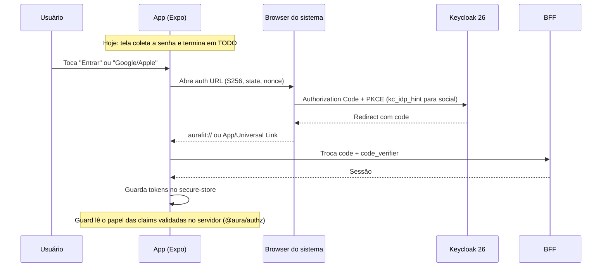

---

## 4. QA adversarial

**Veredito: não está pronto para produção.** Cobertura de testes: **zero** (nenhum `*.test.*`, sem Jest, sem MSW, sem script `test`).

### 4.1 Blocos de achados por severidade (10 blocos)

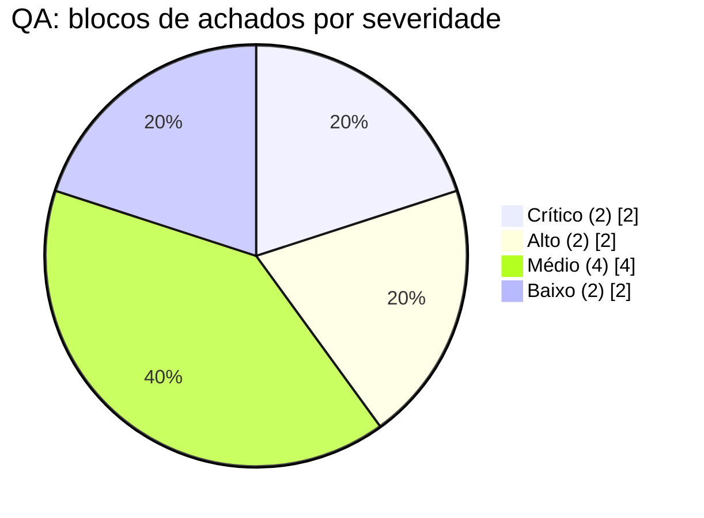

| Sev. | Achado |
|---|---|
| Crítico | Auth e sessão inexistentes. `secureStorage` e `openExternalUrl` são código morto. |
| Crítico | 14 arquivos leem `mockData`. Não há fetch, `useQuery`, loading ou erro. **Sucessos falsos**: `students/new.tsx:43-50` mostra "Aluno cadastrado" sem salvar, `forgot-password.tsx:18` mostra "Link enviado" sem enviar, o chat descarta a mensagem (`chat.tsx:65`). |
| Alto | Parâmetro inválido cai em dado errado: `students/[id].tsx:10` usa `?? students[0]`. "Editar Aluno" abre com formulário vazio. `workout/[id]` mostra o mesmo treino para qualquer id. |
| Alto | Validação: "E-mail ou usuário" usa schema de e-mail (nunca aceita usuário). E-mail sem trim/lowercase. `max()` com mensagem em inglês. Telefone com regex frouxa. Altura e peso sem validação. Signup público oferece papel **Admin** (`signup.tsx:10`). |
| Alto (a confirmar) | `signup.tsx:123-124`: Pressable pai e Checkbox filho podem alternar duas vezes, e o estado volta ao anterior. Precisa confirmar em dispositivo. |
| Médio | Rotas órfãs (`select-role`, `maintenance`, `session-expired`, `access-denied`). Botões sem ação (login social, "Continuar", `onMore`). LGPD e Ajuda desabilitadas em `legalDocs.ts:11-14`. |
| Médio | Sem ErrorBoundary. `KeyboardAvoidingView` com `behavior` indefinido no Android. `LineChart` com largura fixa de 520 estoura em telas de 360px. |
| Médio | Acessibilidade ausente em quase todos os componentes além de Button e Checkbox. |
| Baixo | Faltam `react-native-worklets` (peer do Reanimated 4), react-hook-form, TanStack Query e libs de teste. Sem `try/catch` no `secureStorage`. |

### 4.2 Onde a ausência de guard deixa cada rota

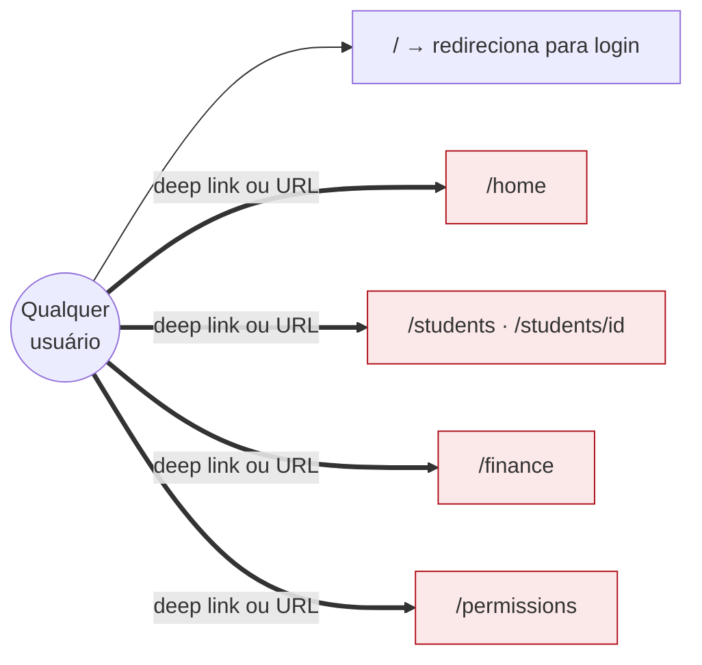

---

## 5. Design system: o que é reaproveitável

### 5.1 Mapa de reaproveitamento

| Item | Mobile alvo (Expo 52, sem NativeWind) | Web alvo (Vite + Tailwind 3.4) |
|---|---|---|
| Paleta, semânticas, avatar tones | Direto | Direto |
| `#b1111b` (primary) | Consistente em todos os arquivos | Consistente |
| Valores de dark mode | Direto (dados) | Direto (dados) |
| Ícones (`paths.ts`, 34) | Direto (dados puros) | Direto, `<svg>` com `currentColor` |
| SVGs de marca, favicon | Direto | Direto |
| Tailwind config | Descartar | Vira preset (sem o preset do NativeWind) |
| `cn.ts` (clsx + tailwind-merge) | Descartar | Direto |
| Componentes de UI | Só como **especificação** | Classes copiam; markup é reescrito |
| Layout do dashboard | Não se aplica | Boa base |
| Telas do personal | Não se aplica | Referência de UX |
| Telas do aluno (`app/(app)`) | Referência de UX | Descartar |
| `mockData`, `public/*`, `package.json`, `global.css` | Descartar | Descartar |

### 5.2 Componentes de UI para a web (25 avaliados pelo agente frontend-web)

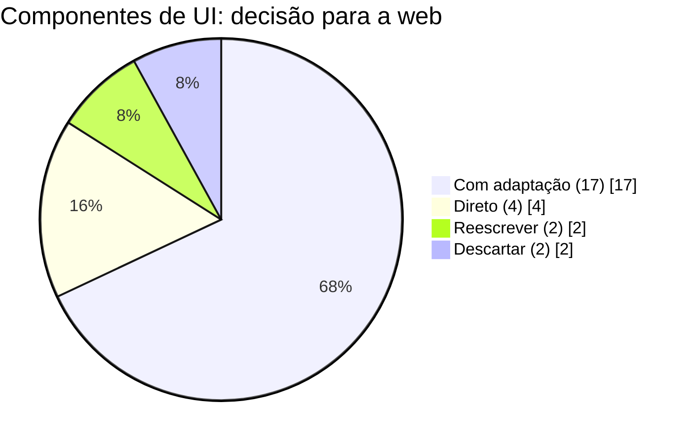

| Decisão | Componentes |
|---|---|
| Direto (4) | StatusBadge/Tag, KPICard, EmptyState, matemática do LineChart |
| Com adaptação (17) | Button, Input, AuthField, Checkbox/Radio, Switch, Tabs, Segmented, Toast, Alert, Avatar, Card, Chip, Stepper, ProgressBar, ProgressRing, Skeleton, ExerciseLibraryCard |
| Reescrever (2) | ConfirmModal (Radix Dialog ou `<dialog>`), DataTable (`<table>` semântica) |
| Descartar (2) | PlanCard, ExerciseRow (fluxo do aluno) |

### 5.3 Problemas de qualidade do design system

**Contraste** (razões calculadas, não medidas em tela). A linha tracejada é o mínimo AA para texto normal (4,5:1).

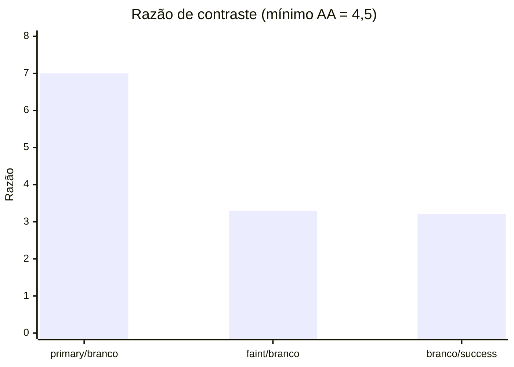

| Problema | Detalhe |
|---|---|
| `faint` `#8d8d8d` sobre branco | ~3,3:1. Falha em AA. Usado em placeholder e texto desabilitado. |
| Branco sobre `success` `#22a45d` | ~3,2:1. Para texto, usar `success.text` `#137a3d`. |
| `warning` `#e2a400` | Não serve como cor de texto. Usar `warning.text` `#855800`. |
| `danger` = `primary` | Mesmo hex `#b1111b`. Confunde marca com erro. |
| `lineHeight` de h1 a h4 | Igual ao `fontSize` (100%). Tende a cortar acentos em português. Recomendado 1,15 a 1,25. |
| Alvos de toque | Button sm/md (32/40), Input sm/md e Checkbox/Radio (34 a 38) ficam abaixo de 44pt. |
| Dark mode | **Especificado nos tokens, não implementado**: nenhum componente usa `dark:`. |
| Cores fixas | Hex hardcoded no spinner do Button, no padrão do Icon, no LineChart e no Avatar. |
| Acessibilidade | Sem `accessibilityLabel` nos componentes lidos. Presença do Avatar e erro versus foco do Input dependem só de cor. Sem estado de foco. |

### 5.4 Pacote compartilhado proposto: `packages/ui-tokens`

Somente dados TypeScript, sem React, RN nem Tailwind como dependência.

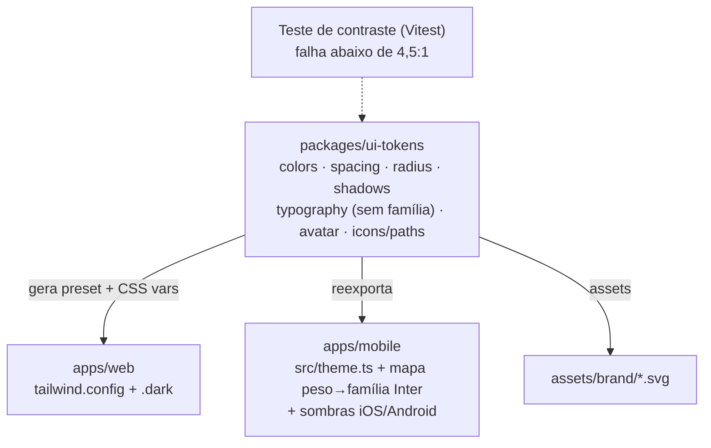

Regras: a web usa o preset com `darkMode: 'class'` e variáveis CSS; o mobile mapeia peso para `Inter_600SemiBold`; um teste de contraste impede a regressão do `faint`.

---

## 6. Reaproveitamento para a web (`apps/web`)

### 6.1 Zod 4 → Zod 3 (schemas do `validation.ts`)

| Linha | Kit (Zod 4) | Alvo (Zod 3) |
|---|---|---|
| 10 | `z.email('msg')` | `z.string().email('msg')` |
| 42 | `z.literal(true, { error })` | `z.literal(true, { errorMap })` ou `z.boolean().refine(...)` |
| 57 | `getFieldErrors<T extends z.ZodType>` | Funciona; com react-hook-form + `zodResolver` deixa de ser necessário |
| demais | `.trim()`, `.regex`, `.min/.max`, `.refine`, `z.infer` | Compatíveis |

O regex interno de e-mail difere entre as versões. Os testes precisam ser ajustados.

### 6.2 Tradução dos primitivos

| Original (RN) | Web |
|---|---|
| `View` / `Text` | `div`, `section`, `span`, `p`, `h1`..`h4` |
| `Pressable` | `<button type="button">` ou `Link` |
| `TextInput` | `<input>` / `<textarea>` com `forwardRef` |
| `Modal` | Radix Dialog ou `<dialog>` (focus trap, Esc) |
| `expo-router` | react-router-dom 6 (`useNavigate`, `useLocation`, `useParams`, `Outlet`) |
| `react-native-svg` | `<svg>` DOM |
| `reanimated` | Transições CSS, `animate-pulse` |
| `useResponsive` | Classes `lg:` do Tailwind |
| `secureStorage` | BFF com cookie httpOnly |
| `mockData` | Orval (`@aura/contracts`) + MSW |
| `useState` + Zod manual | react-hook-form + `zodResolver` |

### 6.3 Ordem de migração para a web

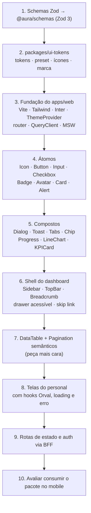

### 6.4 Riscos específicos da web

| Risco | Mitigação |
|---|---|
| Dark mode por `class` não funciona: cores dark são chaves separadas e há hex literais em SVGs | CSS variables (`--surface`) trocadas por `.dark`, `currentColor`, script inline antes do paint |
| `fontFamily` aponta para nomes `Inter_*`, e as chaves `medium/semibold/bold` colidem com as utilities de peso | Self-host de Inter (`@fontsource`), remover essas chaves do preset web. A CSP já permite `font-src 'self'` |
| Tentação de usar `react-native-web` | Não usar: sem HTML semântico, a11y limitada, incompatível com React 18 |
| `tailwind-merge` 3 (relatado pelo agente como voltado ao Tailwind 4) | Fixar `tailwind-merge@^2` na web |
| Larguras fixas (`LineChart` 520, cards de 150px, sidebar inline) | `viewBox`, grid responsivo |
| Kit sem nenhum teste | Vitest + Testing Library + MSW nos componentes novos, começando por Dialog, Tabs, DataTable |

---

## 7. Esforço para chegar à stack alvo (mobile)

Estimativa grosseira do agente de conformidade, para **1 dev experiente**. Total: **27 a 42 dias úteis (5 a 8 semanas)**. Sem verificação em iOS/Android e sem rodar tsc, lint ou testes.

| Etapa | Dias |
|---|---|
| Alinhar versões (downgrade Expo, React, Reanimated, RNGH, new arch) | 2 a 4 |
| Remover NativeWind e migrar para `theme.ts` + StyleSheet + `src/ui/*` | 8 a 12 |
| Monorepo pnpm/Turborepo + pacotes compartilhados (esqueleto) | 2 a 3 |
| Auth (auth-session, PKCE, Keycloak, secure-store, refresh) | 4 a 6 |
| Guards de rota e papel (`@aura/authz`), destino do dashboard | 2 a 3 |
| TanStack Query + Orval no lugar de `mockData` | 4 a 6 |
| react-hook-form nos formulários | 1 a 2 |
| Testes (Jest, jest-expo, RNTL, MSW) e acessibilidade | 4 a 6 |

Gráfico com o ponto médio de cada faixa (em dias):

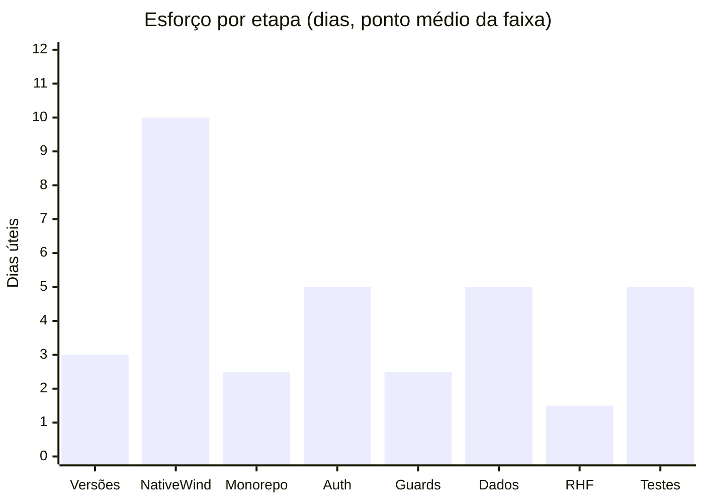

Duas decisões reduzem esse esforço: manter o SDK 57 e atualizar o README economiza cerca de 2 a 4 dias; manter o NativeWind (mudando a regra do projeto) economiza os 8 a 12 dias da migração de estilo.

---

## 8. Decisões que precisam do dono do projeto

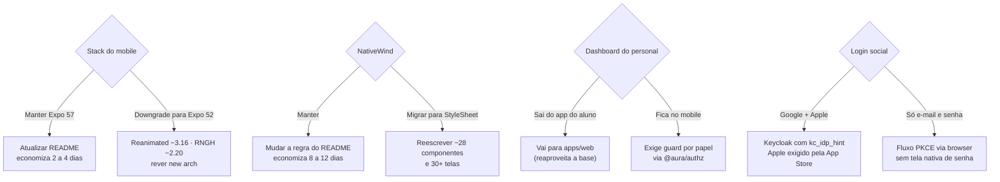

---

## 9. Plano recomendado

Priorização qualitativa (impacto contra esforço, avaliação deste relatório, não medida):

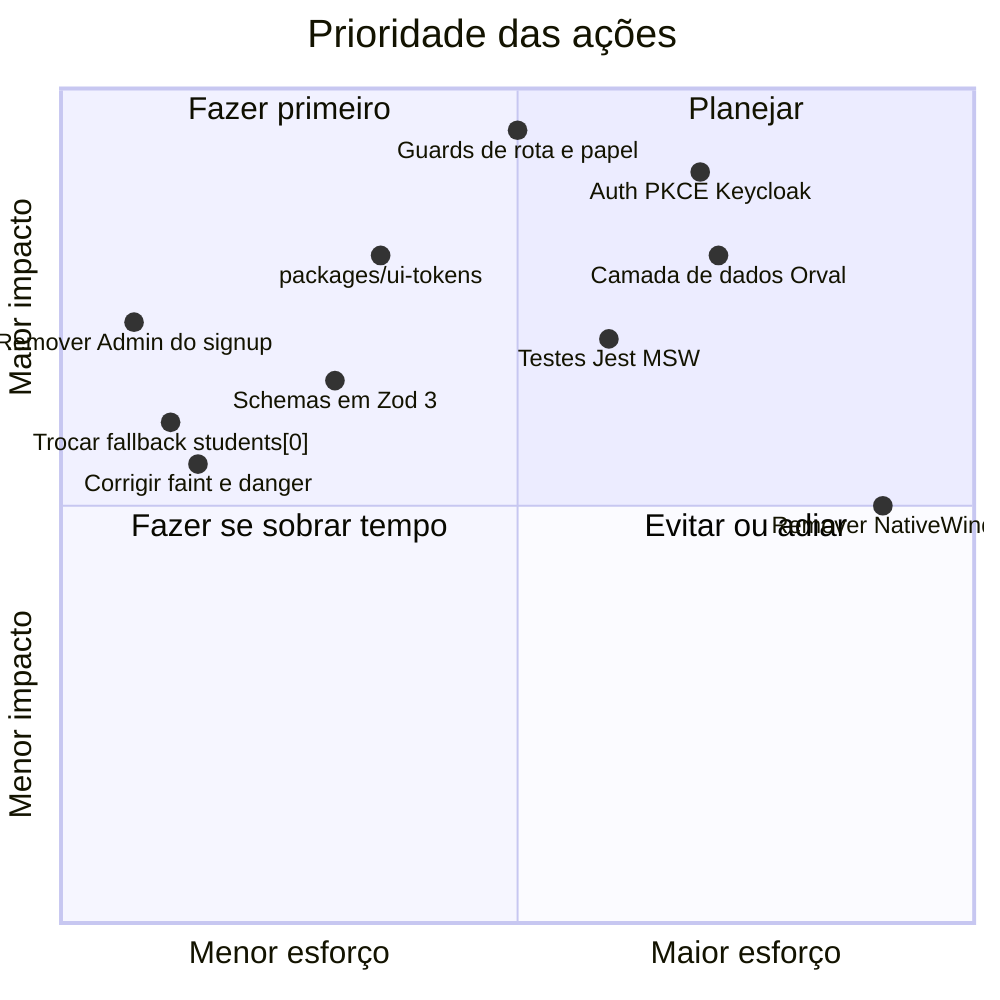

Ordem sugerida:

1. **Verificação básica.** Rodar `npm ci`, `npm run typecheck` e `npm run lint` (o que ninguém conseguiu fazer), conferir as versões com `npx expo install --check` e `npm audit`.
2. **Correções rápidas no kit.** Remover "Admin" do signup, trocar o fallback `students[0]` por "não encontrado", corrigir `faint`, `danger` e `lineHeight`, alinhar o `loginSchema` ao rótulo do campo.
3. **Decisões da seção 8.**
4. **`packages/ui-tokens` e schemas em Zod 3.**
5. **Fundação do `apps/web`**, seguindo a ordem da seção 6.3.
6. **Só então o mobile do aluno**: auth, guards, dados e testes.

Conforme o `CLAUDE.md`, o fluxo passa por `superpowers:brainstorming` e `superpowers:writing-plans`, com os agentes `architect`, `ui-designer`, `frontend-web` e `frontend-mobile`. Antes de declarar qualquer parte concluída, `qa` e `security` revisam a mudança.

---

## 10. Cobertura e limites da análise

| Agente | Leu por completo | Só grep ou cabeçalho |
|---|---|---|
| frontend-mobile | `package.json`, layouts, login, `secureStorage`, `mockData` (via grep de uso) | demais telas |
| ui-designer | `tokens.ts`, `tailwind.config.js`, `global.css`, Button, Input, Checkbox, Avatar, Icon, Logo, AuthBackground, README de marca | DataTable, Toast, Switch, Chip, Stepper, Tabs, LineChart, KPICard, PlanCard e outros componentes; navegação; telas; `mockData` |
| security | `secureStorage`, `openExternalUrl`, `validation`, `legalDocs`, `app.json`, `vercel.json`, `_headers`, `index.html`, layouts, login, select-role | as demais telas (grep por padrões sensíveis) |
| qa | `validation`, `secureStorage`, `openExternalUrl`, `legalDocs`, `dashboardNav`, `useResponsive`, layouts, login, signup, forgot-password, select-role, students/new e [id], chat, Button, Checkbox | demais telas e componentes |
| frontend-web | dashboard (`home`, `students/*`, `finance`) e todos os componentes | `profile`, `exercises/index`, `permissions`; não leu `app/(auth)`, `app/(app)`, `mockData`, `legalDocs` |

Limites que valem para o relatório inteiro:

- Não foi executado nenhum comando de build, typecheck, lint ou teste.
- Nada foi testado em iOS, Android ou navegador. O duplo toggle do checkbox de termos precisa de confirmação em dispositivo.
- As versões `expo 57`, `react-native 0.86`, `typescript 6` e `zod 4` não puderam ser confirmadas por conhecimento próprio dos agentes. Elas constam do `package-lock.json`, mas devem ser checadas no registry.
- Razões de contraste foram calculadas, não medidas em tela.
- As estimativas de esforço são grosseiras e assumem 1 dev experiente.
- Os agentes foram interrompidos uma vez pelo encerramento da sessão anterior; quatro deles foram retomados a partir dos transcripts salvos e entregaram relatório final.
